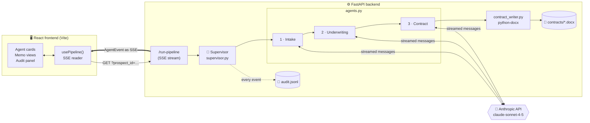
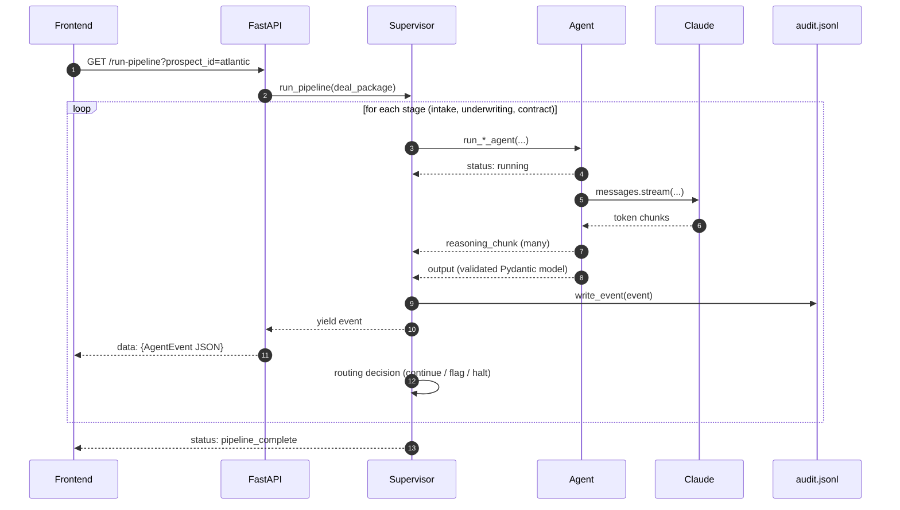
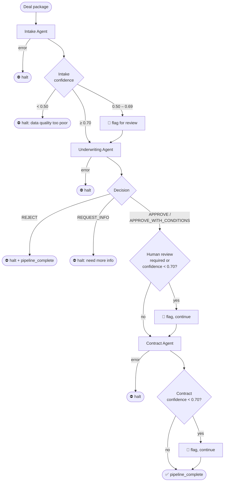
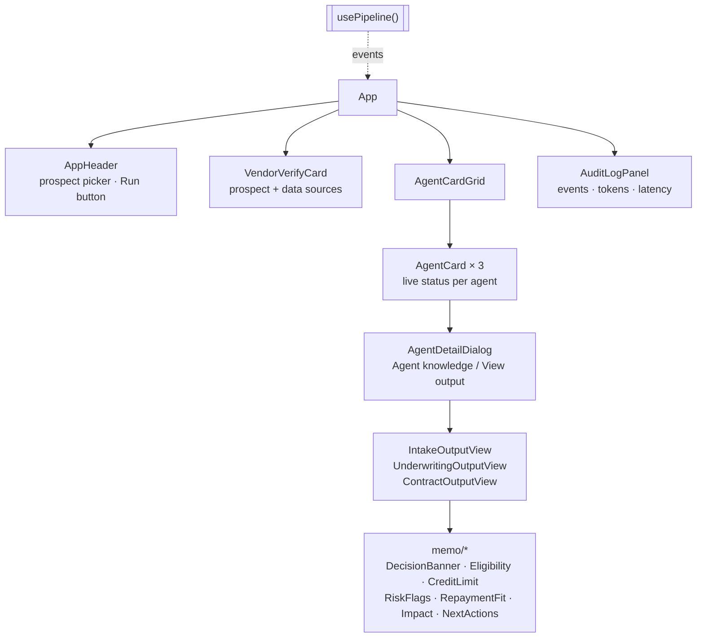

<div align="center">

# 🌊 OceanX AI

### A three-agent underwriting pipeline for SME trade finance

*Deal package in → credit decision, pricing and a signed-ready contract out. Streamed live, fully audited.*


</div>

---

## 📖 Table of contents

1. [What it does](#-what-it-does)
2. [Architecture at a glance](#-architecture-at-a-glance)
3. [The agents](#-the-agents)
4. [The Supervisor and routing rules](#-the-supervisor-and-routing-rules)
5. [Streaming and event model](#-streaming-and-event-model)
6. [Underwriting methodology](#-underwriting-methodology)
7. [Demo prospects](#-demo-prospects)
8. [API reference](#-api-reference)
9. [Frontend](#-frontend)
10. [Project structure](#-project-structure)
11. [Getting started](#-getting-started)
12. [Configuration](#-configuration)
13. [CI](#-ci)
14. [Design decisions](#-design-decisions)
15. [Limitations and roadmap](#-limitations-and-roadmap)

---

## 🎯 What it does

OceanX provides **Import Finance** and **Inventory Finance** to UK and developed-market SMEs that import physical goods on open credit terms, repaid by weekly direct debit.

This project automates the path from raw deal data to a contract:

| Step | Agent | Output |
|:----:|-------|--------|
| 1 | **Intake** | Normalises messy deal data into a structured, confidence-scored summary |
| 2 | **Underwriting** | Applies eligibility gates, calculates credit limits, scans transactions for red flags, and makes a decision |
| 3 | **Contract** | Prices the facility and drafts a deal-specific contract as markdown and a downloadable `.docx` |

A **Supervisor** runs the agents in order, decides after each step whether to continue, flag for human review or halt, and writes every event to an audit log.

> **Note:** there is **no agent framework** (no LangChain, LangGraph or CrewAI). The agents are plain async Python generators that call the Anthropic SDK directly. That keeps control flow explicit and easy to audit.

---

## 🏗 Architecture at a glance



### Request lifecycle



---

## 🤖 The agents

All three agents share the same contract:

- They are **async generators** that yield `AgentEvent` objects.
- They **stream** Claude's tokens as `reasoning_chunk` events, so the UI shows the agent "thinking" live.
- They **validate** the final JSON against a Pydantic model.
- On a schema failure they **retry once**, feeding the validation error back to the model so it can self-correct.
- On any unrecoverable failure they yield an `error` event and stop.

### 1 · Intake Agent

| | |
|---|---|
| **Input** | The raw deal package (company, financials, suppliers, orders, bank data, data sources) |
| **Output** | `IntakeOutput`, a structured summary with `confidence`, `missing_items` and `data_quality_notes` |
| **Deliberately does not** | Analyse individual bank transactions (that is underwriting's job) |

### 2 · Underwriting Agent

| | |
|---|---|
| **Input** | `IntakeOutput` **plus** the raw `bank_transactions` list |
| **Output** | `UnderwritingOutput`: gates, limits, repayment fit, red flags, decision, rationale, next actions |
| **Decisions** | `APPROVE` · `APPROVE_WITH_CONDITIONS` · `REQUEST_INFO` · `REJECT` |
| **Key rule** | Every number must be shown with its formula. The model is told never to invent values. |

### 3 · Contract Agent

| | |
|---|---|
| **Input** | `UnderwritingOutput`, the order summary and company info |
| **Output** | `ContractOutput`: terms, pricing rationale, markdown draft, `.docx` path, edge cases flagged |
| **Runs only for** | `APPROVE` and `APPROVE_WITH_CONDITIONS` |
| **Deliberately does not** | Re-evaluate credit or change the limits |

Pricing bands the agent works from:

| Decision and risk profile | APR | Tenor | Security |
|---|:---:|:---:|---|
| `APPROVE`, no high flags | 8–10% | 90 days | Goods + standard personal guarantee |
| `APPROVE_WITH_CONDITIONS` | 11–14% | 60 days | Goods + PG + monthly statements |
| `APPROVE_WITH_CONDITIONS` + high flag | 14–17% | 45 days | Goods + PG + bank monitoring |

The agent adjusts within a band using limit-to-revenue ratio, DSO and specific red flags. [contract_writer.py](backend/contract_writer.py) then converts the markdown draft into a formatted Word document named `OCX-{company-slug}-{YYYY-MM-DD}.docx`.

---

## 🧭 The Supervisor and routing rules

The Supervisor ([supervisor.py](backend/supervisor.py)) is **not an LLM**. It is deterministic Python, so routing is predictable and testable.



| Stage | Condition | Supervisor action |
|---|---|---|
| Intake | any error | **Halt** |
| Intake | confidence `< 0.50` | **Halt** |
| Intake | confidence `0.50–0.69` | **Flag** (`continue_with_review`) and continue |
| Underwriting | any error | **Halt** |
| Underwriting | `REJECT` | **Halt**, but still emits `pipeline_complete` so the client knows the stream ended |
| Underwriting | `REQUEST_INFO` | **Halt** |
| Underwriting | `requires_human_review` or confidence `< 0.70` | **Flag** and continue |
| Contract | any error | **Halt** |
| Contract | confidence `< 0.70` | **Flag** and continue |

---

## 📡 Streaming and event model

Every agent and the Supervisor communicate through one type, `AgentEvent` ([models.py](backend/models.py)):

```jsonc
{
  "agent":       "intake | underwriting | contract | supervisor",
  "event_type":  "status | reasoning_chunk | output | flag | error",
  "payload":     { },          // shape depends on event_type
  "timestamp":   "2026-05-10T17:28:44.073725+00:00",
  "latency_ms":  12840,        // set on output / error events
  "tokens_used": 5120          // input + output tokens, set on output / error events
}
```

| `event_type` | Meaning | Typical payload |
|---|---|---|
| `status` | Lifecycle change | `{"state": "running"}`, `{"state": "retrying", …}`, `{"state": "pipeline_complete", "decision": …}` |
| `reasoning_chunk` | A streamed token chunk | `{"text": "…"}` |
| `output` | Validated structured result | `{"intake_output": {…}}`, `{"underwriting_output": {…}}`, `{"contract_output": {…}}` |
| `flag` | Supervisor routing decision | `{"action": "halt" \| "continue_with_review", "reason": "…"}` |
| `error` | Failure | `{"error": "…"}` |

The transport is **Server-Sent Events**: each event is one `data: <json>\n\n` message. The frontend can render partial results immediately and the audit panel gets latency and token totals for free.

### Audit trail

[audit.py](backend/audit.py) appends **one JSON line per event** to `backend/audit.jsonl`. Every event is written *before* it is yielded to the client, so the log is complete even if the browser disconnects.

---

## 🧮 Underwriting methodology

The rules live in the system prompt ([prompts.py](backend/prompts.py)), and the Pydantic schema enforces the shape of the answer.

### Data trust hierarchy

When two sources disagree, the higher-trust one wins and the discrepancy is noted as a risk flag.

```
1. Connected bank accounts      ← highest
2. Connected accounting (Xero…)
3. Connected e-commerce (Shopify, Amazon…)
4. Uploaded documents           (supporting evidence only)
5. Meeting notes                (context only)
```

### Eligibility gates

**Basic qualification: all must pass, otherwise `REJECT`.**

| # | Gate | Threshold |
|:-:|---|---|
| 1 | Annual revenue | ≥ USD 1,000,000 |
| 2 | Country | UK, US, Nordics, AU, CA, NZ, SG, HK, FR, DE, ES, PT, NL, BE, CH, LU, IT |
| 3 | Business tenure | ≥ 2 years |
| 4 | Business model | Imports physical goods from overseas |

**Deep qualification: should pass; failures lead to conditions or rejection.**

| # | Gate | Threshold |
|:-:|---|---|
| 1 | Debt ratio | ≤ 10% of annual revenue |
| 2 | Gross margin | ≥ 30% |
| 3 | Cash runway | > 6 months |
| 4 | Overdue AP | ≤ 20% of total AP |
| 5 | Average daily bank balance (ADB) | Sufficient for weekly direct debits |

### Credit limit: two methods, take the lower

```
Method A (liquidity, primary)      Method B (revenue caps)
──────────────────────────────     ───────────────────────────────────
base   = 10 × ADB(90d)             Import Finance    ≤ 10% of revenue
if min_balance < 25% of ADB        Inventory Finance ≤ 10% of revenue
        → cut 25–50%               Combined          ≤ 20% of revenue
if NSF count > 0
        → cut materially / reject

            recommended total = min(Method A, Method B total)
            default split     = 50% Import / 50% Inventory
```

### Repayment fit and impact

```
repayment weeks      = cash_cycle_months × 4        (default cycle: 4 months)
weekly debit         = recommended limit ÷ repayment weeks   (should sit well below ADB ÷ 2)
sales per cycle      = limit ÷ (1 − gross_margin)
incremental sales/yr = sales per cycle × (12 ÷ cycle months)
incremental profit   = incremental sales × gross_margin
```

### Decision rules (applied in order)

1. Any basic gate fails → **`REJECT`**.
2. All deep gates pass and zero high-severity flags → **`APPROVE`**.
3. Concerns that can be fixed with covenants, a lower limit or documentation (one manageable high flag, or 1–2 deep-gate failures) → **`APPROVE_WITH_CONDITIONS`**, with the conditions listed in `next_actions`.
4. 3 or more deep-gate failures, 2 or more high flags, or a high flag indicating active distress → **`REJECT`**.
5. Critical data missing → **`REQUEST_INFO`**.

Any **high-severity red flag** forces `requires_human_review = true`. The agent never sets that field itself; the Supervisor owns it.

### Red-flag scan

Underwriting receives the raw bank transactions and looks for unexplained large outflows, director and related-party transfers, undeclared loans, round-number informal transfers, cash-flow timing mismatches and NSF or failed payments.

---

## 🧪 Demo prospects

Three synthetic, internally consistent deal packages ([mock_data.py](backend/mock_data.py)) cover each branch of the pipeline.

| ID | Company | Expected outcome | Why |
|---|---|---|---|
| `atlantic` | Atlantic Components Ltd | 🟡 `APPROVE_WITH_CONDITIONS` + contract | A £52k undisclosed director's loan is caught as a high-severity red flag |
| `nordic` | Nordic Apparel Co. | 🟢 `APPROVE` + contract | Clean, strong financials |
| `sunrise` | Sunrise Trading Ltd | 🔴 `REJECT`, no contract | Fails tenure, revenue and gross-margin gates; the pipeline halts after underwriting |

Approved runs take roughly 90–180 s; the rejected run roughly 30–60 s.

---

## 🔌 API reference

Base URL: `http://localhost:8000`

| Method | Path | Description |
|:-:|---|---|
| `GET` | `/health` | Liveness check. No external calls. |
| `GET` | `/test-claude` | Makes one tiny Claude call to confirm the SDK and API key work. |
| `GET` | `/prospects` | Lists the demo prospects (`id`, `name`). |
| `GET` | `/run-pipeline?prospect_id=atlantic` | Runs the full pipeline and streams `AgentEvent`s as SSE. Returns `404` for unknown IDs. |
| `GET` | `/download-contract?filename=…` | Downloads a generated `.docx`. Only the basename is accepted (path traversal is rejected). |
| `POST` | `/send-contract` | Emails a generated contract via SMTP. Body: `{ "filename": "…", "customer_name": "…" }`. |

```powershell
curl.exe -N "http://localhost:8000/run-pipeline?prospect_id=nordic"
curl.exe -o contract.docx "http://localhost:8000/download-contract?filename=OCX-nordic-apparel-co-2026-05-11.docx"
```

---

## 🖥 Frontend

A React 19 + TypeScript single-page app that visualises the pipeline as it runs.



- [usePipeline.ts](frontend/src/lib/usePipeline.ts) opens the stream, parses each SSE message and accumulates events, token totals and latency.
- [deriveAgentState.ts](frontend/src/lib/deriveAgentState.ts) turns the raw event list into per-agent state (idle, running, done, flagged, error).
- UI primitives (`components/ui/*`) are shadcn-style wrappers over Radix.
- The backend URL comes from `VITE_API_URL` and defaults to `http://localhost:8000`.

---

## 📂 Project structure

```
oceanx-demo/
├── README.md
├── .circleci/config.yml          # CI: backend check + frontend build
│
├── backend/
│   ├── main.py                   # FastAPI app, SSE endpoint, download + email endpoints
│   ├── supervisor.py             # Deterministic orchestration + routing rules
│   ├── agents.py                 # Intake / Underwriting / Contract agents (Anthropic SDK)
│   ├── prompts.py                # System prompts (the methodology lives here)
│   ├── models.py                 # Pydantic schemas: agent outputs + AgentEvent
│   ├── contract_writer.py        # Markdown → .docx
│   ├── audit.py                  # Append-only audit.jsonl writer
│   ├── mock_data.py              # Three demo deal packages
│   ├── requirements.txt
│   └── .env.example
│
└── frontend/
    ├── src/
    │   ├── App.tsx
    │   ├── components/           # Cards, dialogs, audit panel
    │   │   ├── agents/           # Per-agent output views + memo sections
    │   │   └── ui/               # Radix/shadcn primitives
    │   ├── lib/                  # usePipeline, deriveAgentState, formatters
    │   ├── data/                 # Prospect metadata for the UI
    │   └── types/events.ts       # TypeScript mirror of AgentEvent
    ├── package.json
    └── vite.config.ts
```

Generated at runtime (git-ignored): `backend/audit.jsonl`, `backend/contracts/`.

---

## 🚀 Getting started

### Prerequisites

- Python 3.11+
- Node 22.12+ (see `frontend/.nvmrc`)
- An [Anthropic API key](https://console.anthropic.com/)

### 1. Backend

```powershell
cd backend
python -m venv venv
.\venv\Scripts\Activate.ps1
pip install -r requirements.txt
copy .env.example .env        # then put your real ANTHROPIC_API_KEY in .env
uvicorn main:app --reload --port 8000
```

macOS / Linux: use `source venv/bin/activate` and `cp .env.example .env`.

Verify it:

```powershell
curl http://localhost:8000/health        # {"status":"ok"}
curl http://localhost:8000/test-claude   # {"claude_response":"ready"}
```

### 2. Frontend

```powershell
cd frontend
npm ci
npm run dev                  # http://localhost:5173
```

Pick a prospect, press **Run**, and watch the three agents work.

---

## ⚙️ Configuration

Set these in `backend/.env`.

| Variable | Required | Default | Purpose |
|---|:-:|---|---|
| `ANTHROPIC_API_KEY` | ✅ | | Claude API access |
| `SMTP_USERNAME` | for `/send-contract` | | Sender account |
| `SMTP_PASSWORD` | for `/send-contract` | | Use an app password, not your account password |
| `CONTRACT_RECIPIENT` | for `/send-contract` | | Where the contract email is sent |
| `SMTP_HOST` | | `smtp.gmail.com` | SMTP server |
| `SMTP_PORT` | | `587` | STARTTLS port |
| `SMTP_FROM_NAME` | | `OceanX AI` | Display name on the email |

Frontend: `VITE_API_URL` (default `http://localhost:8000`).

> 🔒 `.env` is git-ignored. Never commit real keys or SMTP passwords.

---

## 🔁 CI

[CircleCI](.circleci/config.yml) runs two jobs on every push, in parallel:

| Job | Steps |
|---|---|
| `backend-check` | `pip install` → `py_compile` on all modules → import the FastAPI app |
| `frontend-build` | `npm ci` → `tsc -b && vite build` |

---

## 🧠 Design decisions

| Decision | Reasoning |
|---|---|
| **No agent framework** | Three fixed steps do not need a graph runtime. Plain async generators keep the control flow readable and let every event be logged. |
| **Deterministic Supervisor** | Routing (halt, flag, continue) is business policy, so it lives in code rather than being left to a model. |
| **Structured outputs via Pydantic + one retry** | Agents must return JSON. Validation errors are fed back to the model once, which fixes most malformed responses cheaply. |
| **Intake does not read transactions** | Underwriting scans the raw ledger itself, so red flags come from source data, not from an intake summary that might smooth them over. |
| **`requires_human_review` is Supervisor-owned** | Agents cannot talk themselves out of a human check. |
| **SSE over WebSockets** | The stream is one-directional, and SSE works over plain HTTP with a simple client. |
| **Audit before yield** | The log is written before each event reaches the client, so it stays complete if the connection drops. |
| **Prompts hold the methodology** | Underwriting rules are readable in one file and can be changed without touching orchestration code. |

---

## ⚠️ Limitations and roadmap

This is a **demo**, not a production credit system.

- Data is **synthetic mock data**; there are no real bank, accounting or e-commerce connectors.
- The contract is a **draft for human review**. Nothing is signed or dispatched through DocuSign, and `/send-contract` only emails the `.docx`.
- Credit rules are enforced by the **LLM following the prompt**, then checked by schema. The numeric gates are not independently recomputed in code.
- The pipeline is **sequential and in-memory**; there is no job queue, persistence layer or authentication.
- The audit log is a local file with no rotation.
- There are **no automated tests** yet.

**Ideas for next steps:**

- [ ] Recompute gates and limits in Python and compare them with the model's numbers
- [ ] Unit tests for Supervisor routing (easy, since it is deterministic) and contract generation
- [ ] Persist runs in a database instead of a flat file
- [ ] Human-approval step before any contract is sent
- [ ] Authentication (CORS is already limited to localhost and Render origins)

---

<div align="center">
<sub>Built with FastAPI · Anthropic Claude · React · Vite · Tailwind</sub>
</div>
